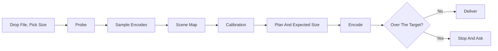

<!-- lang -->

[](README.tr.md)

# VidShrink Player

**Offline video player and toolkit.**

[](https://github.com/Teknesyum/VidShrink-Player/releases/latest)
[](LICENSE)
[](#install)

VidShrink Player is a free, open-source video player built on libmpv, with a timeline
editor, a target-size compressor, a format converter and a screen recorder in the same
window — offline, on Windows, macOS and Linux.

No ads, no watermark, no account, no subscription, no telemetry.

## At A Glance

| Measure | Value | Where it comes from |
|---|---|---|
| Interface languages | 42 (English and Turkish reviewed by people) | [`src/VidShrink.App/Locales/`](src/VidShrink.App/Locales/) |
| Colour themes | 36, light and dark | `src/VidShrink.App/Themes/Palette/` |
| Target-size runs that went over the target | 0 of 36 | [`bench-2026-09-13.md`](docs/olcumler/bench-2026-09-13.md) |
| Quality at equal size against HandBrake x265 `slow` | ahead on 8 of 8 SDR rows, 3 of 4 HDR10 rows | [`handbrake-kiyas-b1-sdr.md`](docs/olcumler/handbrake-kiyas-b1-sdr.md), [`handbrake-kiyas-b4-hdr.md`](docs/olcumler/handbrake-kiyas-b4-hdr.md) |
| Encoding time against HandBrake | 1.64 to 3.73 times longer, 8 of 8 rows | [`handbrake-kiyas-cli.md`](docs/olcumler/handbrake-kiyas-cli.md) |
| Builds per release | 6: `win-x64`, `win-arm64`, `osx-arm64`, `osx-x64`, `linux-x64`, `linux-arm64` | [`release.yml`](.github/workflows/release.yml) |

## Install

No administrator rights, no .NET SDK. Windows 10 or 11, macOS 14 or newer, or a Linux
desktop on X11 or Wayland. FFmpeg and libmpv are required; the installers fetch or name
them for you (details below).

### Install On Windows

Three ways, in this order.

1. **Teknesyum Base — the recommended way.** Download and run
   [`Teknesyum-Base.exe`](https://github.com/Teknesyum/Teknesyum-Base/releases/latest/download/Teknesyum-Base.exe)
   ([`.sha256`](https://github.com/Teknesyum/Teknesyum-Base/releases/latest/download/Teknesyum-Base.exe.sha256)),
   find **VidShrink Player** in the list and install it. Base also updates and uninstalls it
   later. Base is not signed yet, so Windows SmartScreen may warn on first run: choose
   *More info*, then *Run anyway*. Details: [Teknesyum Base](https://github.com/Teknesyum/Teknesyum-Base).
2. **VidShrinkPlayer-Setup.exe.** Download and run
   [`VidShrinkPlayer-Setup.exe`](https://github.com/Teknesyum/VidShrink-Player/releases/latest/download/VidShrinkPlayer-Setup.exe).
   It is a small self-contained program: no PowerShell, no WinGet.
3. **One line of code.** Paste it into PowerShell or the Command Prompt. It downloads the
   latest `VidShrinkPlayer-Setup.exe` to the temp folder and runs it — the same installer as way 2.

   ```powershell
   powershell -NoProfile -Command "[Net.ServicePointManager]::SecurityProtocol=3072; Set-Variable ProgressPreference SilentlyContinue; Set-Location ([IO.Path]::GetTempPath()); irm https://github.com/Teknesyum/VidShrink-Player/releases/latest/download/VidShrinkPlayer-Setup.exe -OutFile VidShrinkPlayer-Setup.exe; .\VidShrinkPlayer-Setup.exe"
   ```

Releases are not code-signed, so a PC with Smart App Control turned on blocks VidShrink
Player whichever way it is installed.

**Uninstall.** `VidShrinkPlayer-Setup.exe --uninstall` removes the shortcuts, the right-click
entries, the Open With registration and the install folder.

**Portable.** `VidShrink-Portable-win-x64.zip` (or `-win-arm64`) from the
[latest release](https://github.com/Teknesyum/VidShrink-Player/releases/latest) runs without
installing: unzip it anywhere, a USB stick included, and start `VidShrink.App.exe`. The
`VidShrink.portable` file beside the exe keeps settings and logs in a `data` folder next to
it. A portable copy does not update itself, adds no shortcuts and writes nothing to the
registry; when a new version is out, the update button opens the download page.

### Install On macOS And Linux

```bash
curl -fsSL https://raw.githubusercontent.com/Teknesyum/VidShrink-Player/main/install-vidshrink.sh | sh
```

To uninstall, run the same installer with `--uninstall`:

```bash
curl -fsSL https://raw.githubusercontent.com/Teknesyum/VidShrink-Player/main/install-vidshrink.sh | sh -s -- --uninstall
```

<details>
<summary>Requirements, what the installer downloads, and the PowerShell script</summary>

Besides the system above you need `ffmpeg` and `ffprobe`. FFmpeg and libmpv never travel
in a release. On Windows the installer downloads them against pinned SHA-256 digests. On
macOS it downloads a pinned libmpv build and, if that fails, prints the Homebrew command;
on Linux it prints your package manager's command.

On Windows the `Install-VidShrink.ps1` script does the same install, and downloads FFmpeg
from the pinned archive when WinGet is missing:

```powershell
powershell -NoProfile -Command "[Net.ServicePointManager]::SecurityProtocol=3072; iex (irm https://raw.githubusercontent.com/Teknesyum/VidShrink-Player/main/Install-VidShrink.ps1)"
```

Checksum verification, the right-click entry, the self-update flow and every switch are in
[`docs/kurulum.md`](docs/kurulum.md).

</details>

### Coming From VidShrink

VidShrink Player is the new name of VidShrink, and the version count starts again at
`0.0.1`. The last release under the old name is 1.2.24; its history is kept in
[`docs/CHANGELOG-VidShrink.md`](docs/CHANGELOG-VidShrink.md).

The rename needs a one-time move. If your VidShrink install does not offer VidShrink
Player as an update, install it once with one of the ways above. Updates after that arrive
as before.

## What It Does

- **Plays video** — libmpv with subtitles, playlists, network streams, an equaliser and
  HDR tone mapping, driven with the mouse.
- **Edits on a timeline** — split, delete, move, speed, colour, LUTs, keyframes, a music
  track, and an export that copies streams when no re-encode is needed.
- **Shrinks to a size** — pick 8, 16 or 25 MB, or any size; the plan and the expected size
  are on screen before anything runs.
- **Converts** — MP4, MKV, WebM, MOV, MXF, GIF and more, ProRes and DNxHR for editing,
  eighteen ready-made targets, and the exact FFmpeg command on screen.
- **Records the screen** — screen, window or region, webcam, microphone and system sound,
  click rings and keys on screen for tutorials.
- **Shares a large file as a link** — upload, link, QR code; only when you press Share.

The window speaks 42 languages and ships 36 colour themes. A headless command line runs
the same engine.

## Isn't This Just mpv And FFmpeg?

Yes, underneath. Playback is libmpv, the engine inside mpv, and every encode is an FFmpeg
command you can read on screen. Both can do everything here from a terminal. What this
adds on top:

- **A window you drive with the mouse** for the jobs those tools leave to flags: subtitle
  styling, equaliser, A-B loop, playlists, recording.
- **A size target that holds.** FFmpeg takes a bitrate; this measures your file first and
  picks codec, resolution, frame rate and quality so the result lands under the size. Over
  36 measured runs it never went over.
- **One file through every step.** Open in the player, cut in the editor, shrink, share —
  without saving and reopening between tools.
- **Hardware encoders probed on your machine** before they are offered, instead of a list
  that fails at run time.

## What It Does Not Do

- The player has no shaders, frame interpolation or scripts, and no HDR passthrough to an
  HDR display; HDR video is tone-mapped to SDR.
- No downloading from a URL. The player opens a direct media address, and does not resolve
  page links; there is no yt-dlp.
- No casting to Chromecast from the player, and no automatic captions.
- No stabilisation and no FFV1 output. ProRes and DNxHR are in the Convert tab only; they
  cannot be driven to a target size.
- No image sequences.
- No live streaming, scenes or game capture. Window capture crops the window's rectangle
  out of the screen, and system sound is found by device name, not by a real loopback.
- No screenshot tool, scrolling capture or OCR.
- On macOS and Linux the recorder has no global hotkeys or click and key display.

## Player

The Player tab is built on **libmpv**. It opens MKV, MP4, WebM, AVI, MOV, TS and the rest,
and plays music files with a cover card. Open a file by dragging it in, from the Explorer
right-click menu on Windows, or from the command line. Playback resumes where you stopped,
for the last five videos you watched.

- **Subtitles** — sidecar files load by themselves and a dropped subtitle file just works.
  Shift the timing in steps, show a second subtitle beside the first, and set the font,
  colour, outline, shadow and background. **OpenSubtitles search and download** sit in the
  window, with your own account.
- **Sound** — audio track and audio delay, a 10-band equaliser with ready presets, loudness
  levelling, and volume up to 200% when you allow it.
- **Picture** — brightness, contrast, saturation, gamma, hue, sharpness, deinterlace, crop,
  rotate, mirror, aspect ratio and zoom. Hardware decoding is a switch. HDR10 and HLG
  video is tone-mapped to SDR by mpv's GPU tone mapper, on by default
  ([`oynatici-hdr-ton-esleme.md`](docs/olcumler/oynatici-hdr-ton-esleme.md)).
- **Seeking** — jumps of 1, 10, 60 and 300 seconds, frame-by-frame steps, chapters,
  bookmarks, an A-B loop, and a thumbnail that follows the pointer along the seek bar.
- **Speed** — 0.25× to 4× in steps of 0.05, one key that flips between two speeds you set,
  and a "speed through silence" mode that runs at 4× while the sound is silent.
- **Playlists** — opens M3U, PLS, WPL and ASX, saves the queue as M3U8, shuffles and
  repeats. Next and previous file in the folder, recent files, and the keyboard's media
  keys.
- **Network streams** — paste, drag or type an address: http, https, rtsp, rtmp, srt or
  udp. HLS streams with several variants get a quality picker. It plays a direct media
  address; it does not resolve a page link such as a YouTube URL.
- **Capture** — a screenshot as PNG or JPG, the current frame to the clipboard, and a clip
  or a GIF cut straight from what is playing.
- **Information** — a panel with the codec, bit depth and SDR, HDR10, HLG or Dolby Vision,
  plus live figures such as dropped frames.
- **Window** — full screen, mini mode, always on top, and a control strip that hides
  itself. Keyboard shortcuts can be reassigned.

One key sends the playing file to the Editor at the same position.

## Editor

Open a video from any tab and cut it on a timeline: split, delete a clip or a range, move
clips, set the speed of each clip from 0.01× to 100×, play it in reverse, undo and redo.

- **Clips** — videos, pictures (a five-second clip each), black or white solid clips, and
  freeze frames. Each clip has scale, position, angle and crop, and the project has an
  output frame: source, 16:9, 9:16 or 1:1.
- **Colour** — one-click auto colour, a master curve, three colour wheels for shadows,
  midtones and highlights, and a 3D LUT (`.cube`) with an intensity slider.
- **Motion** — slow-down and speed-up ramps, smooth slow motion with in-between frames,
  and keyframes for volume and crop.
- **Hiding** — blur a whole clip, or only a region you draw on the monitor.
- **Music** — an audio file lands on its own track, mixed in on export, and can duck
  automatically under speech.
- **Projects** — saved as project files, and exported to or imported from OpenTimelineIO
  (`.otio`).

Then **Save**, **Save As** or **Share** in one of three export modes:

- **Fast** — cuts on keyframes and copies the streams; no re-encode, no quality lost.
- **Smart** — copies what it can and re-encodes only what the cuts need.
- **Full** — re-encodes the whole result.

Clips from several sources that match in codec, size, frame rate and audio layout are
joined without re-encoding when the timeline allows it.

## Shrink To A Target Size

Drag a video in, tap a size, press start. The automatic mode picks the codec, the quality
level, the resolution and the frame rate for **your** file and tells you the expected size
before anything runs.

- **Sizes** — chips for 8 MB (strict e-mail gateways), 16 (WhatsApp), 25 (Gmail) and 180
  (WhatsApp Web), and a slider for everything else. On Windows the Explorer right-click
  menu has "Shrink with VidShrink Player" with six sizes: 8, 16, 20, 25, 50 and 100 MB.
- **Before and after** — a split panel shows the source beside the planned output, with
  zoom, before you commit to the encode.
- **Encoders** — software, plus NVENC, Quick Sync and AMF, each probed on your own machine
  first. VideoToolbox on macOS and VAAPI on Linux can be chosen with the codec lock; they
  are not in the automatic order.
- **Quality score** — the result is scored with **VMAF-NEG**: mean, harmonic mean, 10th
  percentile and worst frame. An optional check after each shrink shows one score in the
  result panel.
- **Batch** — a whole folder goes through the queue, which opens the folder, sleeps or
  shuts the computer down when it finishes.

How the plan is made is under [How Shrinking Works](#how-shrinking-works).

## Convert

MP4, MKV, WebM, MOV, MXF, AVI, GIF, animated WebP and animated AVIF; MP3, M4A, WAV and FLAC
for sound alone. H.264, H.265, VP9, AV1 or a straight stream copy, trimming, and audio
extraction.

- **Editing codecs** — ProRes (Proxy, LT, 422, HQ, 4444) into MOV, and DNxHR (LB, SQ, HQ,
  HQX, 444) into MOV or MXF ([`k12-ara-kodekler.md`](docs/olcumler/k12-ara-kodekler.md)).
- **Ready-made targets** — eighteen of them, WhatsApp, Discord, Telegram, Gmail, Outlook,
  Chromecast, Nest Hub, Apple TV and more, set every field for you.
- **Encoder control** — preset, tune, profile and level for the chosen encoder, and
  two-pass in bitrate mode for H.264, H.265 and VP9.
- **Colour** — keep an HDR source as HDR or tone-map it to SDR; convert SDR to BT.601,
  BT.709 or BT.2020, limited or full range.
- **Audio to video** — an audio file becomes a video with its cover art or a waveform.
- **Tags and repair** — container tags, a cover, chapters, and a Repair preset that drops
  corrupt packets and rebuilds timestamps.

The exact FFmpeg command that will run is on screen.

## Recorder

- **What** — the whole screen, one window or a region you draw. Windows captures with
  ddagrab at up to 60 fps and falls back to gdigrab with a notice; macOS uses avfoundation,
  Linux x11grab. At a 60 fps request ddagrab delivered 59.8 fps where gdigrab gave 24.2 and
  44.8 ([`kaydedici-ddagrab.md`](docs/olcumler/kaydedici-ddagrab.md)). On Windows a webcam
  or capture card can be the main picture instead.
- **Sound** — microphone and system sound chosen by name, so a reordered device list cannot
  quietly swap your microphone; gain, a noise gate and noise suppression.
- **Webcam** — an overlay with its own size and corner, and a green-screen option, on
  Windows, macOS and Linux.
- **For tutorials** — cursor, click rings and click sounds, the keys you press on screen, a
  magnifier, a live preview, and a drawing bar (pen, arrow, box, number, text) that stays
  out of the recording.
- **Control** — global hotkeys F7 to F11 on Windows, with F6 dropping a chapter mark; a
  countdown, a time limit, splitting by time or size, a replay buffer that keeps the last
  moments, tray and mini-recorder modes.
- **Encoders** — x264, x265, SVT-AV1 and VP9, plus NVIDIA NVENC, Intel Quick Sync and AMD
  AMF. **Automatic mode** records three real seconds per candidate on your machine, reads
  ffmpeg's dropped-frame counter and keeps the one that drops none.
- **Output** — MP4, MKV, MOV or GIF, a target size or length budget if you want one, and a
  file that is closed properly when you stop. File names follow a pattern you set. One
  click sends the recording to the Editor, the Player or Share, copies it as a file,
  converts it to GIF, or shrinks it, uploads it and copies the link.

## Share As A Link

Press **Share** in Shrink, the Recorder or the Editor and the file goes up as a link:
**storage.to** for files up to 25 GB, kept one to seven days, or **uguu.se** for files up to
128 MB, kept three hours. The link comes with a QR code for your phone, and a dropped
upload can be retried. Share targets and their measured size ceilings live in
[`paylasim-hedefleri.json`](paylasim-hedefleri.json).

## Languages, Themes And Settings

The whole window speaks 42 languages, from Arabic to Vietnamese, and ships 36 colour
themes — Catppuccin, Dracula, Gruvbox, Nord, Rose Pine, Solarized, Tokyo Night and
twenty-nine more, light and dark. Pick both in Settings; nothing restarts. A language
missing, or a translation reading badly?
[Open an issue](https://github.com/Teknesyum/VidShrink-Player/issues/new).

Settings has a search box in the title bar (Ctrl+F). Ctrl+1 to Ctrl+6 open the six tabs,
F1 opens the user guide in the app language (on a field with a "?" badge it opens that
field's help instead), and the player, editor and window shortcuts can each be reassigned.

**What it changes on your system, and nothing more.** On Windows the installer adds Start
menu and desktop shortcuts, "Open this video with VidShrink Player" and "Shrink with
VidShrink Player" in the Explorer right-click menu (in the first menu on Windows 11), and
VidShrink Player in the **Open with** list for video files —
[written per user](docs/olcumler/kabuk-menusu.md), no administrator rights, and your
default player stays your default. All of it comes off again with one command — see
[Install](#install).

**Updates.** On Windows and macOS the app downloads a new release in the background and
installs it when you close it; switch this off in Settings. On Linux a badge tells you a
new release is out.

## What The Program Shows

Screenshots of the renamed window are being retaken; each slot below says what it will
show.

<!-- screenshot: player-en.png -->
- **Player** — a video filling the window, the tab bar on top and the control strip below.

<!-- screenshot: editor-en.png -->
- **Editor** — the monitor over a timeline cut into clips, with the export mode picker.

<!-- screenshot: shrink-en.png -->
- **Shrink** — the before-and-after split panel, the plan spelled out, the predicted size
  and quality.

<!-- screenshot: convert-en.png -->
- **Convert** — container, codec and quality fields beside the FFmpeg command that will run.

<!-- screenshot: recorder-en.png -->
- **Recorder** — source, sound and webcam pickers, with the measured automatic encoder.

<!-- screenshot: settings-en.png -->
- **Settings** — language and theme pickers, right-click menu entries and the update switch.

## How Shrinking Works

There is no lookup table. Before a decision is made ffmpeg runs against your actual file.



Short sample encodes run at two resolutions and two CRFs, then a calibration pass
re-encodes the same windows four CRF steps apart and reads the bit-cost curve off the two
results. Software encoders then run two passes, hardware a single VBR pass, and an
overshoot stops and asks before a second attempt.

<details>
<summary>The measured table, where it loses, and how the rig is kept honest</summary>

The 36 runs are three 1080p30 clips (high detail, high motion, heavy noise) × three targets
× software and hardware arms × **two repeats**, on an AMD Ryzen 7 9700X, an RTX 5070 Ti and
ffmpeg 9.0-full ([`docs/olcumler/bench-2026-09-13.md`](docs/olcumler/bench-2026-09-13.md)):

| Target | Clip | Encoder | Landed (run 1 / run 2) | Budget fill | Attempts |
|---|---|---|---|---|---|
| 100 MB | high detail | libx264 | 97.30 / 97.37 MB | 97.3% | 1 |
| 100 MB | heavy noise | h264_nvenc | 98.63 / 98.63 MB | 98.6% | 3 |
| 50 MB | high motion | h264_nvenc | 49.88 / 49.88 MB | 99.8% | 1 |
| 25 MB | high motion | libx264 | 24.24 / 24.26 MB | 97.0% | 1 |
| 25 MB | heavy noise | libsvtav1 | 24.28 / 24.28 MB | 97.1% | 1 |
| 8 MB | heavy noise | libsvtav1 | 7.67 / 7.67 MB | 95.9% | 1 |
| 8 MB | high motion | h264_nvenc | 7.71 / 7.71 MB | 96.3% | 1 |

Calibration held in 36/36 and two-pass was picked in 36/36. The hardware arm is bit-identical
across repeats — 0.000 MB drift in 18/18 — and `libx264` drifted at most 0.074 MB.

**The AV1 arm falls short of the target.** 31 of the 36 runs stayed in band; **all five
misses, and the one hard floor breach (6.68 MB against a 6.80 MB floor), are `libsvtav1`** —
`libx264` is 6/6 and `h264_nvenc` 18/18 in band. Repeat-to-repeat drift sits there too, up
to 2.484 MB and 73.5 seconds.

**HandBrake: ahead at equal size, behind on dark banding.** Against HandBrakeCLI 1.11.2's
x265 `slow` preset at equal delivered bytes we lead on 8 of 8 SDR rows
([`handbrake-kiyas-b1-sdr.md`](docs/olcumler/handbrake-kiyas-b1-sdr.md)) and 3 of 4 HDR10
rows ([`handbrake-kiyas-b4-hdr.md`](docs/olcumler/handbrake-kiyas-b4-hdr.md)). Dark scenes
still band more: our AV1 output scores CAMBI 9.31 and 9.39 where HandBrake scores 6.48 and
6.49, lower being better
([`handbrake-kiyas-b7-aciklar.md`](docs/olcumler/handbrake-kiyas-b7-aciklar.md)). We are
also slower: total time 1.64 to 3.73 times HandBrake's on 8 of 8 rows
([`handbrake-kiyas-cli.md`](docs/olcumler/handbrake-kiyas-cli.md)).

**The rig** ([`docs/olcumler/ab-duzenegi.md`](docs/olcumler/ab-duzenegi.md)) prints no
number when the colour space, transfer, primaries or pixel format of an output does not
match the reference. It scores **VMAF-NEG**, **XPSNR** and **SSIM** over frame-locked
streams, on three 60-second parts of a 17-minute source cut on real keyframes, each landing
0.4 s before the requested second. It has to tell a 60 MB encode from a 600 MB one by at
least 1.00 VMAF-NEG point; measured, **+39.26** for HandBrake and **+39.85** for this app.
One known flaw is published as it stands: when a plan lowers the frame rate the rig compares
different moments — an `fps=30` resample alone moved XPSNR **from 1.70 dB to 21.14 dB** —
and verdicts that rested on that path are marked *unfounded* in their own documents.

The recorder's automatic mode is measured the same way:
[three seconds of real recording per candidate](src/VidShrink.Ffmpeg/RecorderAutoProbe.cs),
re-measured in [`auto-mod-yeni-taban.md`](docs/olcumler/auto-mod-yeni-taban.md).

</details>

The long version — calibration, the stopping rule, HDR, perceptual scoring, current limits:
[`docs/motor.md`](docs/motor.md). Every number here comes from a document under
[`docs/olcumler/`](docs/olcumler/).

## How It Compares

mpv, HandBrake, OBS and LosslessCut each do their one job with more depth than this app
does. The rows are from a written survey of the versions named
([`tarama-2026-10-05.md`](docs/piyasa/tarama-2026-10-05.md)).

| Job | Here | Elsewhere |
|---|---|---|
| Playback | libmpv with the controls above | mpv 0.41.0 adds shaders, interpolation, scripts and yt-dlp |
| Target size in MB | Yes; never went over in 36 measured runs | HandBrake 1.11.2 has no target-size field. Shutter Encoder 20.4 and FFmpeg Batch have one; Shutter says it does not guarantee the size |
| Preview before encoding | Split before/after panel | HandBrake encodes a sample to preview |
| Quality at equal bytes | Ahead of HandBrake x265 `slow` on 8 of 8 SDR rows and 3 of 4 HDR10 rows | HandBrake bands less in dark scenes |
| Encoding speed | Slower on 8 of 8 rows; total time 1.64 to 3.73 times HandBrake's | HandBrake |
| Hardware encoders | NVENC, Quick Sync, AMF; VideoToolbox (macOS) and VAAPI (Linux) by codec lock only, and VAAPI has not yet encoded on real hardware here | HandBrake offers VideoToolbox and VAAPI in its normal encoder list |
| Several encodes at once | Up to 4, off until turned on (one job at a time); at most 2 on hardware encoders | HandBrake, FFmpeg Batch |
| Screen recording | Screen, window, region, webcam; system audio on Windows | OBS 32.2.2 adds game capture, scenes and streaming |
| Cutting without re-encoding | Fast and Smart export | LosslessCut 3.69.0 adds track management and EDL/CSV; it calls its own smart cut experimental |

<sub>Product names belong to their owners; VidShrink Player is not affiliated with any of them.</sub>

## Command Line

The same package carries a headless CLI beside the app: `vidshrink` on Windows and Linux,
`vidshrink-cli` on macOS. It calls the same decision engine as the window, so the same
input gives the same ffmpeg arguments; a test holds the two against each other.

```bash
vidshrink kucult clip.mp4 --hedef 25MB              # shrink to a size
vidshrink kucult clip.mp4 --kalite 80 --kodek av1   # shrink to a quality score
vidshrink plan clip.mp4 --hedef 8MB --json          # plan and arguments only, no encode
```

Every long option also answers to an English alias (`--hedef` is `--target`, `--kodek` is
`--codec`). Every option, the full alias table and the exit codes:
[`docs/cli.md`](docs/cli.md).

### Watch Folder

```bash
vidshrink izle ~/Gelen --cikti ~/Giden --hedef 25MB             # run until Ctrl+C
vidshrink izle ~/Gelen --cikti ~/Giden --hedef 25MB --bir-kez   # drain the folder, then exit
```

`izle` shrinks every video that lands in the folder. `--cikti` is the output folder and is
required; it cannot be the watched folder. When a file is taken, where progress is kept,
letter case and exit codes: [`docs/cli.md`](docs/cli.md#watch-folder).

## For Developers

### Build From Source

Building from a clone needs the .NET 8 SDK, plus `ffmpeg`, `ffprobe` and libmpv on the
machine to run what you built.

```bash
dotnet build VidShrink.sln -c Release
```

```bash
dotnet test VidShrink.sln
```

The code keeps its internal `VidShrink.*` names: `VidShrink.Core` makes the decisions,
`VidShrink.Ffmpeg` runs the processes, `VidShrink.Player` drives libmpv and
`VidShrink.App` is the Avalonia window. The project layout and the design rules are in
[`CONTRIBUTING.md`](CONTRIBUTING.md).

### Documentation

[Usage](docs/kullanim.md) · [Command line](docs/cli.md) · [Engine](docs/motor.md) ·
[Install and update](docs/kurulum.md) · [Measurements](docs/olcumler/) ·
[Roadmap](docs/YOL-HARITASI.md) · [Changelog](CHANGELOG.md) · [Contributing](CONTRIBUTING.md)

### Roadmap

Measured, open, in this order — the detail is in [`docs/YOL-HARITASI.md`](docs/YOL-HARITASI.md).

- **Close the last gap to HandBrake: banding in dark scenes** (CAMBI 9.31 and 9.39 against
  6.48 and 6.49). The bar is the same rig, the same source, and that gap at zero.
- **The AV1 arm's undershoot** — all five band misses are `libsvtav1`.
- **Time-align the measurement rig**, so plans that lower the frame rate can be measured.
- **Open the peak-rate cap**, which also fixes hardware overshoot at small targets.
- **Calibrate the scale and frame-rate penalties against measured quality**.
- **Per-scene encoding** — measured, and not shipped: it did not pass the quality gate
  ([`sahne-butcesi.md`](docs/olcumler/sahne-butcesi.md)).

## Contributing

Open an issue first, keep a pull request to one concern, run `dotnet test VidShrink.sln` —
nothing merges red — and sign off each commit under the
[Developer Certificate of Origin](DCO) with `git commit -s`. The repository language is
English, and contributions come under the project's licence.

Translations are welcome too. English and Turkish are reviewed; the other 40 languages are
machine translated and say so in the language picker. Each language is one folder under
[`src/VidShrink.App/Locales/`](src/VidShrink.App/Locales/) — correct a line there in a pull
request. A Weblate project for translating in the browser is being prepared
([`docs/dagitim/weblate.md`](docs/dagitim/weblate.md)).

If the app saves you time, [sponsoring Teknesyum](https://github.com/sponsors/Teknesyum)
keeps it going.

## License

[AGPL-3.0-or-later](LICENSE). Copyright (C) 2026 Teknesyum.

FFmpeg and libmpv are separate programs under their own licences; VidShrink Player
redistributes neither and links no GPL code into itself ([`docs/kurulum.md`](docs/kurulum.md)).

Third-party material distributed inside the source tree — the Fluent UI System Icons the
icon set is cut from (MIT) — is listed in [`THIRD-PARTY-NOTICES.md`](THIRD-PARTY-NOTICES.md).

## Privacy

This program will not transfer any information to other networked systems unless
specifically requested by the user or the person installing or operating it.

<details>
<summary>Every request the app can make</summary>

The requests it can make, what triggers each, and whose privacy policy applies:

- **Update check** — asks GitHub for the latest release. On by default on Windows and
  macOS; switch it off in Settings. [GitHub Privacy Statement](https://docs.github.com/en/site-policy/privacy-policies/github-general-privacy-statement)
- **Installer** — downloads FFmpeg and libmpv from GitHub releases, pinned by SHA-256.
  [GitHub Privacy Statement](https://docs.github.com/en/site-policy/privacy-policies/github-general-privacy-statement)
- **Share** — uploads a file only when you press Share, to the host you pick.
  [storage.to privacy](https://storage.to/privacy) · [uguu.se FAQ](https://uguu.se/faq)
- **OpenSubtitles** — signs in and searches only when you use it.
  [OpenSubtitles privacy policy](https://www.opensubtitles.com/en/privacy/)
- **Network streams** — the player connects to an address only when you open one.

</details>

<!-- signature -->
<div align="center">

<a href="https://github.com/sponsors/Teknesyum"></a>
&nbsp;
<a href="LICENSE"></a>

</div>
