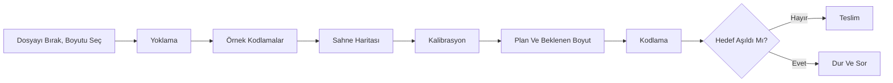

<!-- lang -->

[](README.md)

# VidShrink Player

**Çevrimdışı video oynatıcı ve araç takımı.**

[](https://github.com/Teknesyum/VidShrink-Player/releases/latest)
[](LICENSE)
[](#kurulum)

VidShrink Player, libmpv üzerine kurulu ücretsiz, açık kaynak bir video oynatıcı; aynı
pencerede zaman çizelgeli düzenleyici, hedef boyuta sıkıştırıcı, biçim dönüştürücü ve ekran
kaydedici var — çevrimdışı; Windows, macOS ve Linux'ta.

Reklam yok, filigran yok, hesap yok, abonelik yok, telemetri yok.

## Kısaca

| Ölçü | Değer | Nereden geliyor |
|---|---|---|
| Arayüz dili | 42 (İngilizce ve Türkçe insan elinden geçti) | [`src/VidShrink.App/Locales/`](src/VidShrink.App/Locales/) |
| Renk teması | 36, açık ve koyu | `src/VidShrink.App/Themes/Palette/` |
| Hedef boyutu aşan koşum | 36'da 0 | [`bench-2026-09-13.md`](docs/olcumler/bench-2026-09-13.md) |
| HandBrake x265 `slow`'a karşı eş boyutta kalite | 8 SDR satırının 8'inde, 4 HDR10 satırının 3'ünde önde | [`handbrake-kiyas-b1-sdr.md`](docs/olcumler/handbrake-kiyas-b1-sdr.md), [`handbrake-kiyas-b4-hdr.md`](docs/olcumler/handbrake-kiyas-b4-hdr.md) |
| HandBrake'e karşı kodlama süresi | 1,64 ile 3,73 kat uzun, 8 satırın 8'inde | [`handbrake-kiyas-cli.md`](docs/olcumler/handbrake-kiyas-cli.md) |
| Sürüm başına derleme | 6: `win-x64`, `win-arm64`, `osx-arm64`, `osx-x64`, `linux-x64`, `linux-arm64` | [`release.yml`](.github/workflows/release.yml) |

## Kurulum

Yönetici hakkı yok, .NET SDK yok. Windows 10 ya da 11, macOS 14 ve üstü, ya da X11/Wayland
koşan bir Linux masaüstü. FFmpeg ve libmpv gerekiyor; kurucular bunları sizin için indiriyor
ya da komutunu söylüyor (ayrıntı aşağıda).

### Windows'a Kurulum

Üç yol, bu sırayla.

1. **Teknesyum Base — önerilen yol.**
   [`Teknesyum-Base.exe`](https://github.com/Teknesyum/Teknesyum-Base/releases/latest/download/Teknesyum-Base.exe)
   dosyasını ([`.sha256`](https://github.com/Teknesyum/Teknesyum-Base/releases/latest/download/Teknesyum-Base.exe.sha256))
   indirip çalıştırın, listeden **VidShrink Player**'ı bulup kurun. Base sonradan
   güncellemeyi ve kaldırmayı da yapar. Base henüz imzalı değil; Windows SmartScreen ilk
   açılışta uyarabilir: *Ek bilgi*'yi, sonra *Yine de çalıştır*'ı seçin. Ayrıntı:
   [Teknesyum Base](https://github.com/Teknesyum/Teknesyum-Base).
2. **VidShrink-Setup.exe.**
   [`VidShrink-Setup.exe`](https://github.com/Teknesyum/VidShrink-Player/releases/latest/download/VidShrink-Setup.exe)
   dosyasını indirip çalıştırın. Kendi başına çalışan küçük bir program: PowerShell de WinGet
   de gerekmez.
3. **Tek satır kod.** PowerShell'e ya da Komut İstemi'ne yapıştırın. Son
   `VidShrink-Setup.exe`'yi geçici klasöre indirip çalıştırır — 2. yoldaki kurucunun aynısı.

   ```powershell
   powershell -NoProfile -Command "[Net.ServicePointManager]::SecurityProtocol=3072; Set-Variable ProgressPreference SilentlyContinue; Set-Location ([IO.Path]::GetTempPath()); irm https://github.com/Teknesyum/VidShrink-Player/releases/latest/download/VidShrink-Setup.exe -OutFile VidShrink-Setup.exe; .\VidShrink-Setup.exe"
   ```

Sürümler kod imzalı değil; bu yüzden Akıllı Uygulama Denetimi açık olan bir bilgisayar
VidShrink Player'ı hangi yolla kurulursa kurulsun engeller.

**Kaldırma.** `VidShrink-Setup.exe --uninstall` kısayolları, sağ tık girdilerini, Birlikte aç
kaydını ve kurulum klasörünü siliyor.

**Taşınabilir.** [Son sürümdeki](https://github.com/Teknesyum/VidShrink-Player/releases/latest)
`VidShrink-Portable-win-x64.zip` (ya da `-win-arm64`) kurulmadan çalışır: herhangi bir yere,
USB belleğe de açın ve `VidShrink.App.exe`'yi başlatın. Exe'nin yanındaki `VidShrink.portable`
dosyası ayarları ve günlüğü yanındaki `data` klasöründe tutar. Taşınabilir kopya kendini
güncellemez, kısayol eklemez, kayıt defterine yazmaz; yeni sürüm çıkınca güncelleme düğmesi
indirme sayfasını açar.

### macOS Ve Linux'a Kurulum

```bash
curl -fsSL https://raw.githubusercontent.com/Teknesyum/VidShrink-Player/main/install-vidshrink.sh | sh
```

Kaldırmak için aynı kurucuyu `--uninstall` ile çalıştırın:

```bash
curl -fsSL https://raw.githubusercontent.com/Teknesyum/VidShrink-Player/main/install-vidshrink.sh | sh -s -- --uninstall
```

<details>
<summary>Gerekenler, kurucunun indirdikleri ve PowerShell betiği</summary>

Yukarıdaki sistemin yanında `ffmpeg` ve `ffprobe` gerekiyor. FFmpeg ve libmpv sürümle
birlikte gelmiyor. Windows'ta kurucu bunları pinlenmiş SHA-256 özetlerine karşı indiriyor.
macOS'ta pinlenmiş bir libmpv derlemesini indiriyor, tutmazsa Homebrew komutunu yazıyor;
Linux'ta paket yöneticinizin komutunu yazıyor.

Windows'ta `Install-VidShrink.ps1` betiği aynı kurulumu yapar; WinGet yoksa
FFmpeg'i pinlenmiş arşivden indirir:

```powershell
powershell -NoProfile -Command "[Net.ServicePointManager]::SecurityProtocol=3072; iex (irm https://raw.githubusercontent.com/Teknesyum/VidShrink-Player/main/Install-VidShrink.ps1)"
```

Sağlama doğrulaması, sağ tık girdisi, kendi kendini güncelleme akışı ve bütün anahtarlar
[`docs/kurulum.tr.md`](docs/kurulum.tr.md) içinde.

</details>

### VidShrink'ten Geçiş

VidShrink Player, VidShrink'in yeni adı; sürüm sayımı `0.0.1`'den yeniden başlıyor. Eski
adla çıkan son sürüm 1.2.24; geçmişi
[`docs/CHANGELOG-VidShrink.md`](docs/CHANGELOG-VidShrink.md) içinde duruyor.

Ad değişimi bir kerelik bir geçiş istiyor. VidShrink kurulumunuz VidShrink Player'ı
güncelleme olarak önermezse, yukarıdaki yollardan biriyle bir kez kurun. Ondan sonraki
güncellemeler eskisi gibi gelir.

## Ne Yapar

- **Video oynatır** — altyazı, çalma listesi, ağ akışı, ekolayzer ve HDR ton eşlemeyle
  libmpv, fareyle kullanılan bir pencerede.
- **Zaman çizelgesinde düzenler** — bölme, silme, taşıma, hız, renk, LUT, anahtar kare,
  müzik izi; yeniden kodlama gerekmiyorsa akışları kopyalayan dışa aktarma.
- **Boyuta küçültür** — 8, 16 ya da 25 MB'ı ya da herhangi bir boyutu seçin; plan ve
  beklenen boyut daha hiçbir şey koşmadan ekranda.
- **Dönüştürür** — MP4, MKV, WebM, MOV, MXF, GIF ve fazlası, kurgu için ProRes ve DNxHR,
  on sekiz hazır hedef ve koşacak FFmpeg komutunun kendisi ekranda.
- **Ekranı kaydeder** — ekran, pencere ya da bölge, kamera, mikrofon ve sistem sesi;
  anlatım videoları için tıklama halkaları ve ekranda tuşlar.
- **Büyük dosyayı bağlantı olarak paylaşır** — yükle, bağlantı, QR kodu; yalnız Paylaş'a
  bastığınızda.

Pencere 42 dil konuşuyor ve 36 renk temasıyla geliyor. Başsız bir komut satırı aynı motoru
koşturuyor.

## Bunu mpv Ve FFmpeg Zaten Yapmıyor Mu?

Evet, altta. Oynatma libmpv, yani mpv'nin içindeki motor; her kodlama da ekranda
okuyabildiğiniz bir FFmpeg komutu. İkisi buradaki her şeyi terminalden yapabilir. Üstüne
eklenenler:

- **Fareyle kullanılan bir pencere** — o araçların anahtara bıraktığı işler için: altyazı
  biçemi, ekolayzer, A-B tekrarı, çalma listeleri, kayıt.
- **Tutan bir boyut hedefi.** FFmpeg bit hızı alır; bu önce dosyanızı ölçer, sonra kodeği,
  çözünürlüğü, kare hızını ve kaliteyi sonuç boyutun altına düşecek şekilde seçer. Ölçülen
  36 koşumda hiç aşmadı.
- **Her adımda aynı dosya.** Oynatıcıda açın, düzenleyicide kesin, küçültün, paylaşın —
  araçlar arasında kaydedip yeniden açmadan.
- **Makinenizde yoklanan donanım kodlayıcıları** — sunulmadan önce deneniyor; koşarken
  düşen bir liste yerine.

## Yapmadıkları

- Oynatıcıda gölgelendirici, ara kare üretimi ya da betik yok; HDR ekrana HDR geçirme de
  yok, HDR video SDR'ye ton eşleniyor.
- URL'den indirme yok. Oynatıcı doğrudan medya adresini açıyor, sayfa bağlantılarını
  çözmüyor; yt-dlp yok.
- Oynatıcıdan Chromecast'e gönderme yok, otomatik altyazı üretimi yok.
- Sabitleme yok, FFV1 çıktısı yok. ProRes ve DNxHR yalnız Dönüştür sekmesinde; hedef boyuta
  sürülemiyorlar.
- Resim dizisi yok.
- Canlı yayın, sahne ya da oyun yakalama yok. Pencere yakalama pencerenin dikdörtgenini
  ekrandan kırpıyor; sistem sesi gerçek bir geri döngüyle değil aygıt adıyla bulunuyor.
- Ekran görüntüsü aracı, kaydırmalı yakalama ya da OCR yok.
- macOS ve Linux'ta kaydedicide genel kısayollar ve tıklama ile tuş gösterimi yok.

## Oynatıcı

Oynatıcı sekmesi **libmpv** üzerine kurulu. MKV, MP4, WebM, AVI, MOV, TS ve gerisini
açıyor; müzik dosyalarını kapak kartıyla çalıyor. Dosyayı sürükleyerek, Windows'ta Explorer
sağ tık menüsünden ya da komut satırından açın. İzlediğiniz son beş videoda oynatma kaldığı
yerden sürüyor.

- **Altyazı** — yan dosyalar kendiliğinden yükleniyor, sürüklenen altyazı dosyası doğrudan
  çalışıyor. Zamanlamayı adım adım kaydırın, ilkinin yanında ikinci bir altyazı gösterin;
  yazı tipini, rengi, anahattı, gölgeyi ve zemini ayarlayın. **OpenSubtitles araması ve
  indirmesi** pencerenin içinde, kendi hesabınızla.
- **Ses** — ses izi ve ses gecikmesi, hazır ayarlı 10 bantlı ekolayzer, ses düzeyi
  dengeleme ve izin verdiğinizde %200'e kadar ses.
- **Görüntü** — parlaklık, karşıtlık, doygunluk, gama, renk tonu, keskinlik, taramayı
  giderme, kırpma, döndürme, aynalama, en-boy oranı ve yakınlaştırma. Donanım çözme bir
  anahtar. HDR10 ve HLG video mpv'nin GPU ton eşleyicisiyle SDR'ye ton eşleniyor,
  varsayılan açık ([`oynatici-hdr-ton-esleme.md`](docs/olcumler/oynatici-hdr-ton-esleme.md)).
- **Gezinme** — 1, 10, 60 ve 300 saniyelik atlamalar, kare kare ilerleme, bölümler, yer
  imleri, A-B tekrarı ve süre çubuğunda işaretçiyi izleyen küçük resim.
- **Hız** — 0,05'lik adımlarla 0,25× ile 4× arası, belirlediğiniz iki hız arasında tek
  tuşla geçiş, ve ses sustuğu sürece 4× koşan "sessizliği hızlı geç" kipi.
- **Çalma listeleri** — M3U, PLS, WPL ve ASX açıyor, kuyruğu M3U8 olarak kaydediyor,
  karıştırıyor ve tekrarlıyor. Klasördeki sonraki ve önceki dosya, son dosyalar ve
  klavyenin medya tuşları.
- **Ağ akışları** — adresi yapıştırın, sürükleyin ya da yazın: http, https, rtsp, rtmp, srt
  ya da udp. Birden çok çeşidi olan HLS akışlarında kalite seçici var. Doğrudan medya
  adresini oynatıyor; YouTube adresi gibi bir sayfa bağlantısını çözmüyor.
- **Yakalama** — PNG ya da JPG ekran görüntüsü, o anki kareyi panoya kopyalama ve oynayan
  videodan doğrudan kesilen klip ya da GIF.
- **Bilgi** — kodeği, bit derinliğini ve SDR, HDR10, HLG ya da Dolby Vision'ı gösteren bir
  panel; yanında düşen kare gibi canlı sayılar.
- **Pencere** — tam ekran, mini kip, her zaman üstte ve kendiliğinden gizlenen bir kontrol
  şeridi. Klavye kısayolları yeniden atanabiliyor.

Tek tuş, oynayan dosyayı aynı konumda Düzenleyici'ye gönderiyor.

## Düzenleyici

Herhangi bir sekmeden bir videoyu açın ve zaman çizelgesinde kesin: bölün, bir klibi ya da
bir aralığı silin, klipleri taşıyın, her klibin hızını 0,01× ile 100× arasında ayarlayın,
tersine oynatın, geri alın ve yineleyin.

- **Klipler** — videolar, resimler (her biri beş saniyelik bir klip), siyah ya da beyaz düz
  renk klipleri ve dondurulmuş kareler. Her klibin ölçeği, konumu, açısı ve kırpması var;
  projenin de bir çıktı çerçevesi: kaynak, 16:9, 9:16 ya da 1:1.
- **Renk** — tek tıkla otomatik renk, ana eğri, gölge, orta ton ve parlak alan için üç renk
  çarkı, ve yoğunluk kaydırıcılı 3B LUT (`.cube`).
- **Hareket** — yavaşlayan ve hızlanan rampalar, ara kare üreten yumuşak ağır çekim, ses ve
  kırpma için anahtar kareler.
- **Gizleme** — klibin tamamını ya da monitörde çizdiğiniz bir bölgeyi bulanıklaştırma.
- **Müzik** — bir ses dosyası kendi izine düşüyor, dışa aktarmada karışıyor ve konuşmanın
  altında kendiliğinden kısılabiliyor.
- **Projeler** — proje dosyası olarak kaydediliyor; OpenTimelineIO'ya (`.otio`) dışa
  aktarılıyor ve oradan içe alınıyor.

Sonra üç dışa aktarma kipinden biriyle **Kaydet**, **Farklı Kaydet** ya da **Paylaş**:

- **Hızlı** — anahtar karelerden keser, akışları kopyalar; yeniden kodlama yok, kalite kaybı
  yok.
- **Akıllı** — kopyalayabildiğini kopyalar, yalnız kesimlerin gerektirdiğini yeniden kodlar.
- **Tam** — sonucun tamamını yeniden kodlar.

Kodeği, boyutu, kare hızı ve ses düzeni eşleşen birden çok kaynaktan gelen klipler, zaman
çizelgesi izin verdiğinde yeniden kodlanmadan birleştiriliyor.

## Hedef Boyuta Küçültme

Videoyu sürükleyin, bir boyuta dokunun, başlat deyin. Otomatik kip kodeki, kalite düzeyini,
çözünürlüğü ve kare hızını **sizin** dosyanız için seçiyor ve beklenen boyutu daha hiçbir
şey koşmadan söylüyor.

- **Boyutlar** — 8 MB (katı e-posta geçitleri), 16 (WhatsApp), 25 (Gmail) ve 180 (WhatsApp
  Web) için yongalar, gerisi için kaydırıcı. Windows'ta Explorer sağ tık menüsünde
  "VidShrink Player ile Küçült" altı boyutla duruyor: 8, 16, 20, 25, 50 ve 100 MB.
- **Öncesi ve sonrası** — bölmeli panel, kodlamaya başlamadan önce kaynağı planlanan
  çıktının yanında, yakınlaştırmayla gösteriyor.
- **Kodlayıcılar** — yazılım ile NVENC, Quick Sync ve AMF; her biri önce kendi makinenizde
  yoklanıyor. macOS'ta VideoToolbox ve Linux'ta VAAPI kodek kilidiyle seçilebiliyor; otomatik
  sırada değiller.
- **Kalite puanı** — sonuç **VMAF-NEG** ile puanlanıyor: ortalama, harmonik ortalama, 10.
  yüzdelik ve en kötü kare. İsteğe bağlı bir denetim her küçültmeden sonra sonuç panelinde
  tek bir puan gösteriyor.
- **Toplu iş** — bir klasörün tamamı kuyruktan geçiyor; kuyruk bitince klasörü açıyor,
  bilgisayarı uyutuyor ya da kapatıyor.

Planın nasıl çıktığı [Küçültme Nasıl Çalışır](#küçültme-nasıl-çalışır) altında.

## Dönüştürme

MP4, MKV, WebM, MOV, MXF, AVI, GIF, hareketli WebP ve hareketli AVIF; yalnız ses için MP3,
M4A, WAV ve FLAC. H.264, H.265, VP9, AV1 ya da doğrudan akış kopyası, kırpma ve ses çıkarma.

- **Kurgu kodekleri** — ProRes (Proxy, LT, 422, HQ, 4444) MOV'a, DNxHR (LB, SQ, HQ, HQX,
  444) MOV ya da MXF'e ([`k12-ara-kodekler.md`](docs/olcumler/k12-ara-kodekler.md)).
- **Hazır hedefler** — on sekiz tane; WhatsApp, Discord, Telegram, Gmail, Outlook,
  Chromecast, Nest Hub, Apple TV ve fazlası her alanı sizin yerinize dolduruyor.
- **Kodlayıcı denetimi** — seçilen kodlayıcı için ön ayar, ayar, profil ve düzey; H.264,
  H.265 ve VP9'da bit hızı kipinde iki geçiş.
- **Renk** — HDR kaynağı HDR tutun ya da SDR'ye ton eşleyin; SDR'yi BT.601, BT.709 ya da
  BT.2020'ye, sınırlı ya da tam aralığa çevirin.
- **Sesten videoya** — bir ses dosyası kapak resmiyle ya da dalga biçimiyle videoya dönüyor.
- **Etiketler ve onarım** — kapsayıcı etiketleri, kapak, bölümler, ve bozuk paketleri atıp
  zaman damgalarını yeniden kuran Onar ön ayarı.

Koşacak FFmpeg komutunun kendisi ekranda.

## Kaydedici

- **Ne** — tüm ekran, tek pencere ya da çizdiğiniz bir bölge. Windows ddagrab ile 60 kareye
  kadar yakalıyor, olmazsa bunu söyleyip gdigrab'a düşüyor; macOS avfoundation, Linux
  x11grab kullanıyor. 60 kare istendiğinde ddagrab 59,8 kare verdi; gdigrab 24,2 ve 44,8
  ([`kaydedici-ddagrab.md`](docs/olcumler/kaydedici-ddagrab.md)). Windows'ta ana görüntü
  ekran yerine bir kamera ya da yakalama kartı da olabiliyor.
- **Ses** — mikrofon ve sistem sesi adıyla seçiliyor, böylece sırası değişen bir aygıt
  listesi mikrofonunuzu sessizce değiştiremiyor; kazanç, gürültü kapısı ve gürültü bastırma.
- **Kamera** — kendi boyutu ve köşesi olan bir kamera katmanı, yeşil perde seçeneğiyle;
  Windows, macOS ve Linux'ta.
- **Anlatım videoları için** — imleç, tıklama halkaları ve tıklama sesi, bastığınız tuşlar
  ekranda, büyüteç, canlı önizleme, ve kayda girmeyen bir çizim çubuğu (kalem, ok, kutu,
  numara, metin).
- **Denetim** — Windows'ta F7-F11 genel kısayolları, F6 ile bölüm işareti; geri sayım, süre
  sınırı, süreye ya da boyuta göre bölme, son anları tutan tekrar arabelleği, tepsi ve mini
  kaydedici kipleri.
- **Kodlayıcılar** — x264, x265, SVT-AV1 ve VP9, artı NVIDIA NVENC, Intel Quick Sync ve AMD
  AMF. **Otomatik kip** makinenizde her aday için üç gerçek saniye kaydediyor, ffmpeg'in
  düşen kare sayacını okuyor ve kare düşürmeyeni tutuyor.
- **Çıktı** — MP4, MKV, MOV ya da GIF; isterseniz hedef boyut ya da süre bütçesi; durdurunca
  düzgün kapanan bir dosya. Dosya adları sizin belirlediğiniz bir kalıba uyuyor. Tek tıkla
  kayıt Düzenleyici'ye, Oynatıcı'ya ya da Paylaş'a gidiyor, dosya olarak kopyalanıyor,
  GIF'e çevriliyor ya da küçültülüp yüklenip bağlantısı kopyalanıyor.

## Bağlantı Olarak Paylaşma

Küçült'te, Kaydedici'de ya da Düzenleyici'de **Paylaş**'a basın, dosya bağlantı olarak
yüklensin: 25 GB'a kadar dosyalar için bir ile yedi gün tutan **storage.to**, ya da 128 MB'a
kadar dosyalar için üç saat tutan **uguu.se**. Bağlantı telefonunuz için bir QR koduyla
geliyor, yarıda kopan yükleme yeniden denenebiliyor. Paylaşım hedefleri ve ölçülmüş boyut
tavanları [`paylasim-hedefleri.json`](paylasim-hedefleri.json) içinde.

## Diller, Temalar Ve Ayarlar

Pencerenin tamamı 42 dil konuşuyor, Arapçadan Vietnamcaya, ve yanında 36 renk teması
geliyor — Catppuccin, Dracula, Gruvbox, Nord, Rose Pine, Solarized, Tokyo Night ve yirmi
dokuz tane daha, açık ve koyu. İkisini de Ayarlar'dan seçiyorsunuz, hiçbir şey yeniden
başlamıyor. Diliniz yok mu, ya da çeviri kötü mü duruyor?
[Issue açın](https://github.com/Teknesyum/VidShrink-Player/issues/new).

Ayarlar'ın arama kutusu başlık çubuğunda (Ctrl+F). Ctrl+1 ile Ctrl+6 altı sekmeyi açıyor,
F1 kullanım kılavuzunu uygulamanın dilinde açıyor; oynatıcı, düzenleyici ve pencere
kısayolları ayrı ayrı yeniden atanabiliyor.

**Sisteminizde neyi değiştirdiği, ve fazlası değil.** Windows'ta kurucu Başlat menüsüne ve
masaüstüne kısayol, Explorer sağ tık menüsüne "Bu videoyu VidShrink Player ile aç" ve
"VidShrink Player ile Küçült" girdileri (Windows 11'de ilk menüde) ve video dosyalarının
**Birlikte aç** listesine VidShrink Player ekliyor —
[kullanıcı başına yazılıyor](docs/olcumler/kabuk-menusu.md), yönetici hakkı istemiyor ve
varsayılan oynatıcınız varsayılan kalıyor. Hepsi tek komutla geri alınıyor — bkz.
[Kurulum](#kurulum).

**Güncellemeler.** Windows'ta ve macOS'ta uygulama yeni sürümü arka planda indiriyor ve siz
kapatınca kuruyor; Ayarlar'dan kapatılır. Linux'ta yeni sürümü bir rozet haber veriyor.

## Program Ne Yaptığını Gösterir

Yeni adlı pencerenin ekran görüntüleri yeniden çekiliyor; aşağıdaki her yer neyi
göstereceğini söylüyor.

<!-- ekran-goruntusu: player-tr.png -->
- **Oynatıcı** — pencereyi dolduran bir video, üstte sekme çubuğu, altta kontrol şeridi.

<!-- ekran-goruntusu: editor-tr.png -->
- **Düzenleyici** — kliplere bölünmüş zaman çizelgesinin üstünde monitör, dışa aktarma kipi
  seçicisiyle.

<!-- ekran-goruntusu: shrink-tr.png -->
- **Küçült** — öncesi-sonrası bölmeli panel, açık açık yazılmış plan, öngörülen boyut ve
  kalite.

<!-- ekran-goruntusu: convert-tr.png -->
- **Dönüştür** — kapsayıcı, kodek ve kalite alanları, yanında koşacak FFmpeg komutu.

<!-- ekran-goruntusu: recorder-tr.png -->
- **Kaydedici** — kaynak, ses ve kamera seçicileri, ölçülerek seçilen otomatik kodlayıcıyla.

<!-- ekran-goruntusu: settings-tr.png -->
- **Ayarlar** — dil ve tema seçicileri, sağ tık menüsü girdileri ve güncelleme anahtarı.

## Küçültme Nasıl Çalışır

Arama tablosu yok. Karar verilmeden önce ffmpeg gerçek dosyanıza karşı koşuyor.



İki çözünürlük ve iki CRF'te kısa örnek kodlamalar koşuyor, sonra bir kalibrasyon geçişi
aynı pencereleri dört CRF adımı arayla yeniden kodlayıp iki sonuçtan bit maliyeti eğrisini
okuyor. Yazılım kodlayıcıları sonra iki geçiş, donanım tek VBR geçişi koşuyor; aşım olursa
durup ikinci denemeden önce soruyor.

<details>
<summary>Ölçülmüş tablo, geride kaldığı yerler ve düzeneğin dürüst tutulması</summary>

36 koşum: üç 1080p30 klip (yüksek detay, yüksek hareket, ağır gürültü) × üç hedef × yazılım
ve donanım kolu × **ikişer tekrar**; AMD Ryzen 7 9700X, RTX 5070 Ti ve ffmpeg 9.0-full
([`docs/olcumler/bench-2026-09-13.md`](docs/olcumler/bench-2026-09-13.md)):

| Hedef | Klip | Kodlayıcı | Çıkan (1. / 2. koşum) | Bütçe doluluğu | Deneme |
|---|---|---|---|---|---|
| 100 MB | yüksek detay | libx264 | 97,30 / 97,37 MB | %97,3 | 1 |
| 100 MB | ağır gürültü | h264_nvenc | 98,63 / 98,63 MB | %98,6 | 3 |
| 50 MB | yüksek hareket | h264_nvenc | 49,88 / 49,88 MB | %99,8 | 1 |
| 25 MB | yüksek hareket | libx264 | 24,24 / 24,26 MB | %97,0 | 1 |
| 25 MB | ağır gürültü | libsvtav1 | 24,28 / 24,28 MB | %97,1 | 1 |
| 8 MB | ağır gürültü | libsvtav1 | 7,67 / 7,67 MB | %95,9 | 1 |
| 8 MB | yüksek hareket | h264_nvenc | 7,71 / 7,71 MB | %96,3 | 1 |

Kalibrasyon 36/36 tuttu, 36/36 iki geçişli seçildi. Donanım kolu tekrarlar arasında bit
düzeyinde aynı — 18/18 koşumda 0,000 MB sapma — `libx264` en fazla 0,074 MB kaydı.

**AV1 dalı hedefin altına düşüyor.** 36 koşumun 31'i bant içinde kaldı; **beş kaçağın
beşi de, tek sert taban ihlali de (6,80 MB tabana karşı 6,68 MB) `libsvtav1`** — `libx264`
6/6, `h264_nvenc` 18/18 bant içi. Tekrarlar arası sapma da orada: 2,484 MB'a ve 73,5
saniyeye kadar.

**HandBrake: eş boyutta öndeyiz, karanlık bantlaşmada gerideyiz.** HandBrakeCLI 1.11.2'nin
x265 `slow` ön ayarına karşı, teslim edilen bayt eşitken 8 SDR satırının 8'inde
([`handbrake-kiyas-b1-sdr.md`](docs/olcumler/handbrake-kiyas-b1-sdr.md)) ve 4 HDR10 satırının
3'ünde ([`handbrake-kiyas-b4-hdr.md`](docs/olcumler/handbrake-kiyas-b4-hdr.md)) öndeyiz.
Karanlık sahneler hâlâ daha çok bantlaşıyor: AV1 çıktımız CAMBI 9,31 ve 9,39, HandBrake 6,48
ve 6,49 alıyor; düşük olan iyi
([`handbrake-kiyas-b7-aciklar.md`](docs/olcumler/handbrake-kiyas-b7-aciklar.md)). Ayrıca daha
yavaşız: 8 satırın 8'inde toplam süre HandBrake'in 1,64 ile 3,73 katı
([`handbrake-kiyas-cli.md`](docs/olcumler/handbrake-kiyas-cli.md)).

**Düzenek** ([`docs/olcumler/ab-duzenegi.md`](docs/olcumler/ab-duzenegi.md)), bir çıktının
renk uzayı, transferi, primaries'i ya da piksel biçimi referansla eşleşmediğinde hiç sayı
basmıyor. **VMAF-NEG**, **XPSNR** ve **SSIM**'i kare kilitli akışlar üzerinden, 17 dakikalık
bir kaynağın gerçek anahtar karelerde kesilmiş üç adet 60 saniyelik parçasında puanlıyor;
her parça istenen saniyeden 0,4 sn önceye oturuyor. 60 MB'lık bir kodlamayı 600 MB'lıktan en
az 1,00 VMAF-NEG puanıyla ayırmak zorunda; ölçülen, HandBrake için **+39,26**, bu uygulama
için **+39,85**. Bilinen bir kusur olduğu gibi yayımlı: plan kare hızını düşürdüğünde düzenek
farklı anları karşılaştırıyor — yalnız `fps=30` yeniden örneklemesi XPSNR'ı **1,70 dB'den
21,14 dB'ye** taşıdı — ve o yola dayanan hükümler kendi belgelerinde *temelsiz* diye
işaretli.

Kaydedicinin otomatik kipi de aynı yolla ölçülüyor:
[aday başına üç saniyelik gerçek kayıt](src/VidShrink.Ffmpeg/RecorderAutoProbe.cs), yeniden
ölçümü [`auto-mod-yeni-taban.md`](docs/olcumler/auto-mod-yeni-taban.md) içinde.

</details>

Uzun hâli — kalibrasyon, durma ölçütü, HDR, algısal puanlama, bugünkü sınırlar:
[`docs/motor.tr.md`](docs/motor.tr.md). Buradaki her sayı [`docs/olcumler/`](docs/olcumler/)
altındaki bir belgeden geliyor.

## Karşılaştırma

mpv, HandBrake, OBS ve LosslessCut'ın her biri kendi tek işini bu uygulamadan daha derin
yapıyor. Satırlar, adı geçen sürümlerin yazılı bir taramasından
([`tarama-2026-10-05.md`](docs/piyasa/tarama-2026-10-05.md)).

| İş | Burada | Başka yerde |
|---|---|---|
| Oynatma | Yukarıdaki denetimlerle libmpv | mpv 0.41.0'da gölgelendiriciler, ara kare üretimi, betikler ve yt-dlp de var |
| MB olarak hedef boyut | Var; ölçülen 36 koşumda hiç aşılmadı | HandBrake 1.11.2'de hedef boyut alanı yok. Shutter Encoder 20.4 ve FFmpeg Batch'te var; Shutter boyutu garanti etmediğini söylüyor |
| Kodlamadan önce önizleme | Bölmeli öncesi/sonrası paneli | HandBrake önizleme için bir örnek kodluyor |
| Eş boyutta kalite | 8 SDR satırının 8'inde ve 4 HDR10 satırının 3'ünde HandBrake x265 `slow`'un önünde | HandBrake karanlık sahnede daha az bantlaşıyor |
| Kodlama hızı | 8 satırın 8'inde daha yavaş; toplam süre HandBrake'in 1,64 ile 3,73 katı | HandBrake |
| Donanım kodlayıcıları | NVENC, Quick Sync, AMF; VideoToolbox (macOS) ve VAAPI (Linux) yalnız kodek kilidiyle, VAAPI burada gerçek donanımda henüz kodlamadı | HandBrake VideoToolbox ve VAAPI'yi olağan kodlayıcı listesinde sunuyor |
| Aynı anda birkaç kodlama | En çok 4, varsayılan kapalı (tek iş); donanım kodlayıcıda en çok 2 | HandBrake, FFmpeg Batch |
| Ekran kaydı | Ekran, pencere, bölge, kamera; Windows'ta sistem sesi | OBS 32.2.2'de oyun yakalama, sahneler ve yayın da var |
| Yeniden kodlamadan kesme | Hızlı ve Akıllı dışa aktarma | LosslessCut 3.69.0'da iz yönetimi ve EDL/CSV de var; kendi akıllı kesimine deneysel diyor |

<sub>Ürün adları sahiplerine aittir; VidShrink Player'ın hiçbiriyle bağı yoktur.</sub>

## Komut satırı

Aynı paket, pencerenin yanında başsız bir komut satırı aracı da taşıyor: Windows ve
Linux'ta `vidshrink`, macOS'ta `vidshrink-cli`. Pencerenin çağırdığı karar motorunu
çağırıyor, yani aynı girdi aynı ffmpeg argümanlarını veriyor; bir test ikisini
karşılaştırıyor.

```bash
vidshrink kucult clip.mp4 --hedef 25MB              # boyuta küçült
vidshrink kucult clip.mp4 --kalite 80 --kodek av1   # kalite puanına küçült
vidshrink plan clip.mp4 --hedef 8MB --json          # yalnız plan ve argümanlar, kodlama yok
```

Her uzun anahtarın bir de İngilizce takma adı var (`--hedef` ile `--target`, `--kodek` ile
`--codec` aynı anahtar). Bütün anahtarlar, takma ad tablosunun tamamı ve çıkış kodları:
[`docs/cli.tr.md`](docs/cli.tr.md).

### İzlenen klasör

```bash
vidshrink izle ~/Gelen --cikti ~/Giden --hedef 25MB             # Ctrl+C'ye kadar koşar
vidshrink izle ~/Gelen --cikti ~/Giden --hedef 25MB --bir-kez   # klasörü boşaltır, çıkar
```

`izle`, klasöre düşen her videoyu küçültüyor. `--cikti` çıktı klasörüdür ve zorunludur;
izlenen klasörün kendisi olamaz. Dosyanın ne zaman alındığı, ilerlemenin nerede tutulduğu,
harf büyüklüğü ve çıkış kodları: [`docs/cli.tr.md`](docs/cli.tr.md).

## Geliştiriciler İçin

### Kaynaktan Derleme

Depoyu derlemek için .NET 8 SDK gerekiyor; derlediğinizi çalıştırmak için makinede `ffmpeg`,
`ffprobe` ve libmpv de olmalı.

```bash
dotnet build VidShrink.sln -c Release
```

```bash
dotnet test VidShrink.sln
```

Kod içerideki `VidShrink.*` adlarını koruyor: `VidShrink.Core` kararları veriyor,
`VidShrink.Ffmpeg` süreçleri koşturuyor, `VidShrink.Player` libmpv'yi sürüyor,
`VidShrink.App` Avalonia penceresi. Proje yerleşimi ve tasarım kuralları
[`CONTRIBUTING.md`](CONTRIBUTING.md) içinde.

### Belgeler

[Kullanım](docs/kullanim.tr.md) · [Komut satırı](docs/cli.tr.md) · [Motor](docs/motor.tr.md) ·
[Kurulum ve güncelleme](docs/kurulum.tr.md) · [Ölçümler](docs/olcumler/) ·
[Yol haritası](docs/YOL-HARITASI.md) · [Sürüm notları](CHANGELOG.md) · [Katkı](CONTRIBUTING.md)

### Yol Haritası

Ölçülmüş, açık, bu sırayla — ayrıntı [`docs/YOL-HARITASI.md`](docs/YOL-HARITASI.md) içinde.

- **HandBrake'le kalan son açığı kapatmak: karanlık sahnede bantlaşma** (CAMBI 9,31 ve
  9,39'a karşı 6,48 ve 6,49). Ölçüt aynı düzenek, aynı kaynak ve o açığın sıfır olması.
- **AV1 dalının hedef altına düşmesi** — beş bant kaçağının beşi `libsvtav1`.
- **Ölçüm düzeneğinin zamanda hizalanması**, ki kare hızı düşüren planlar ölçülebilsin.
- **Tepe hızı tavanını açmak**, ki bu küçük hedeflerdeki donanım aşımını da düzeltiyor.
- **Ölçek ve kare hızı cezalarını ölçülmüş kaliteye göre kalibre etmek**.
- **Sahne başına kodlama** — ölçüldü, ürüne girmedi: kalite kapısını geçmedi
  ([`sahne-butcesi.md`](docs/olcumler/sahne-butcesi.md)).

## Katkı

Önce bir konu açın, değişikliği tek derde tutun, `dotnet test VidShrink.sln` koşun —
kırmızı hiçbir şey birleşmez — ve her commit'i [Developer Certificate of Origin](DCO)
uyarınca `git commit -s` ile imzalayın. Depo dili İngilizce; katkılar projenin lisansı
altında girer.

Çeviri katkısı da açık. İngilizce ve Türkçe gözden geçti; öteki 40 dil makine çevirisi ve
dil seçicide bunu söylüyor. Her dil [`src/VidShrink.App/Locales/`](src/VidShrink.App/Locales/)
altında bir klasör — yanlış satırı orada bir çekme isteğiyle düzeltin. Tarayıcıdan çeviri
için bir Weblate projesi hazırlanıyor ([`docs/dagitim/weblate.md`](docs/dagitim/weblate.md)).

Uygulama size zaman kazandırıyorsa [Teknesyum'a sponsor olmak](https://github.com/sponsors/Teknesyum)
onu sürdürüyor.

## Lisans

[AGPL-3.0-or-later](LICENSE). Telif hakkı (C) 2026 Teknesyum.

FFmpeg ve libmpv kendi lisansları altında ayrı programlardır; VidShrink Player ikisini de
yeniden dağıtmaz ve içine GPL kodu bağlamaz ([`docs/kurulum.tr.md`](docs/kurulum.tr.md)).

Kaynak ağacının içinde dağıtılan üçüncü taraf malzeme — simge takımının kesildiği Fluent UI
System Icons (MIT) — [`THIRD-PARTY-NOTICES.md`](THIRD-PARTY-NOTICES.md) dosyasında.

<a id="gizlilik"></a>

## Gizlilik

Bu program, kullanıcı ya da onu kuran veya çalıştıran kişi özellikle
istemedikçe başka ağ sistemlerine bilgi aktarmaz.

<details>
<summary>Uygulamanın yapabildiği her istek</summary>

Yapabildiği istekler, her birini neyin başlattığı ve o anda kimin gizlilik politikasının
geçerli olduğu:

- **Güncelleme denetimi** — GitHub'a son sürümü sorar. Windows'ta ve macOS'ta varsayılan
  açık; Ayarlar'dan kapatılır. [GitHub Gizlilik Bildirimi](https://docs.github.com/en/site-policy/privacy-policies/github-general-privacy-statement)
- **Kurucu** — FFmpeg ve libmpv'yi GitHub sürümlerinden, SHA-256'ya sabitlenmiş olarak indirir.
  [GitHub Gizlilik Bildirimi](https://docs.github.com/en/site-policy/privacy-policies/github-general-privacy-statement)
- **Paylaş** — dosyayı yalnız Paylaş'a bastığınızda, seçtiğiniz sunucuya yükler.
  [storage.to gizlilik](https://storage.to/privacy) · [uguu.se SSS](https://uguu.se/faq)
- **OpenSubtitles** — yalnız siz kullandığınızda oturum açar ve arar.
  [OpenSubtitles gizlilik politikası](https://www.opensubtitles.com/en/privacy/)
- **Ağ akışları** — oynatıcı bir adrese yalnız siz açtığınızda bağlanır.

</details>

<!-- signature -->
<div align="center">

<a href="https://github.com/sponsors/Teknesyum"></a>
&nbsp;
<a href="LICENSE"></a>

</div>
